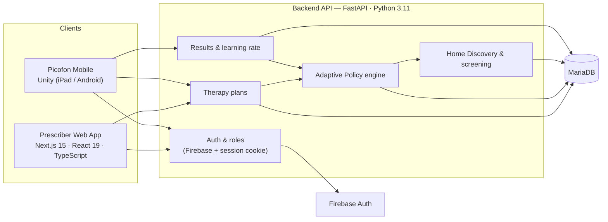

# PICOFON — Adaptive Speech & Phonological Awareness Therapy Platform (Case Study)

> **This repository contains no production source code.** PICOFON is a joint project with the
> Universitat Oberta de Catalunya (UOC) and co-founder Llorenç. This case study documents the
> architecture, the main technical decisions and my contribution, with permission from both
> co-owners. All diagrams, screenshots and examples use synthetic data.

PICOFON is a digital therapy platform for children aged 4–8 that trains **phonological awareness**
and helps prevent **dyslexia**, in **Spanish and Catalan**. Children play therapy games on a tablet
(Unity), therapists and parents prescribe and follow the therapy from a web app (React / Next.js),
and a Python backend decides, level by level, what each child should practise next.

**My role:** full-stack lead developer — backend (FastAPI), web front end (Next.js / React),
data model, and the adaptive therapy engine ("Adaptive Policy"). <!-- TODO Esteban: dates, team size -->

---

## Highlights

- **Adaptive Policy engine** — a curriculum ("mesh") per language and age, split into stages and
  skills. After every level the backend computes a *learning rate* and decides the next skill,
  stage and difficulty. Clients never decide; they only ask and render.
- **Home Discovery** — a short, game-first onboarding route that doubles as a **screening**: the
  child plays a few levels across skills (with a story scene in between), and the result places
  the child at the right starting stage of the curriculum.
- **Data-driven configuration** — curricula, discovery steps and scenes live in configuration
  tables, so therapists can change order, skills or scenes **without a deployment**.
- **Three official therapy flows** — therapist-managed, therapist-prescribed / parent-assisted,
  and AI-prescribed / parent-assisted — all sharing one execution loop.
- **Multilingual by design** — Spanish and Catalan content, with per-language skill enablement.
- **Tested in isolation** — the adaptive modules are covered by isolated pytest suites that run
  without a database.

## Architecture at a glance

More detail: [docs/architecture.md](docs/architecture.md) ·
[docs/adaptive-policy.md](docs/adaptive-policy.md) · [docs/home-discovery.md](docs/home-discovery.md)

## Tech stack

| Layer | Technologies |
|---|---|
| Backend | Python 3.11, FastAPI, SQLAlchemy, Pydantic, pytest, Scalar (OpenAPI docs) |
| Database | MariaDB, versioned SQL scripts with verification and rollback |
| Web front end | Next.js 15, React 19, TypeScript, Tailwind CSS 4, Radix UI, Zustand, Zod, React Hook Form, TanStack Table, Recharts, i18next |
| Mobile | Unity (C#) — iPad and Android |
| Auth | Firebase Authentication + HttpOnly backend session |
| Infra | Docker, Linux server, automated MySQL backups |

## Key technical decisions

1. **The backend owns every therapeutic decision.** Policy, stage, next skill, learning rate and
   difficulty are computed server-side. React and Unity only initiate or render. This keeps three
   clients consistent and lets the therapy logic evolve without app-store releases.
2. **Configuration over code.** Curricula and onboarding steps are rows, not `if` statements.
   Adding a scene or reordering the screening is a data change.
3. **Reuse the existing contract.** Home Discovery levels and story scenes are delivered as regular
   therapy plans with a `plan_type`, so the Unity game needed no new loop — only a new renderer.
4. **Explicit, typed error codes.** Every business rule violation returns a stable code
   (e.g. "discovery already in progress"), which the clients map to UI states and translations.
5. **Safe database changes.** Each schema change ships as numbered scripts: DDL → seed →
   verification → activation → monitoring → rollback.

## Screenshots & demo

<!-- TODO Esteban: add screenshots with synthetic children only, and a 1–2 min demo video -->
| Prescriber web app | Child progress report | Picofon game |
|---|---|---|
| `media/prescriber-dashboard.png` | `media/progress-report.png` | `media/game-level.png` |

Demo video: _coming soon_

## Research context

PICOFON is developed in collaboration with the UOC. <!-- TODO Esteban: link papers, posters,
Transfer Day presentation, or grants -->

## What I learned

- Designing a domain model where clinical rules (curriculum, screening) are configurable by
  non-developers.
- Coordinating API contracts across three clients (web, Unity, backend) owned by different people.
- Shipping incremental versions of an adaptive engine (v1 → v2 → v3) to production without
  breaking children already in therapy.

## Contact

Esteban Peñaherrera — <!-- TODO: LinkedIn / email / website -->

---

_© PICOFON. Text and diagrams in this repository are shared for portfolio purposes; the PICOFON
software, content and curricula are not included and are not licensed here._
