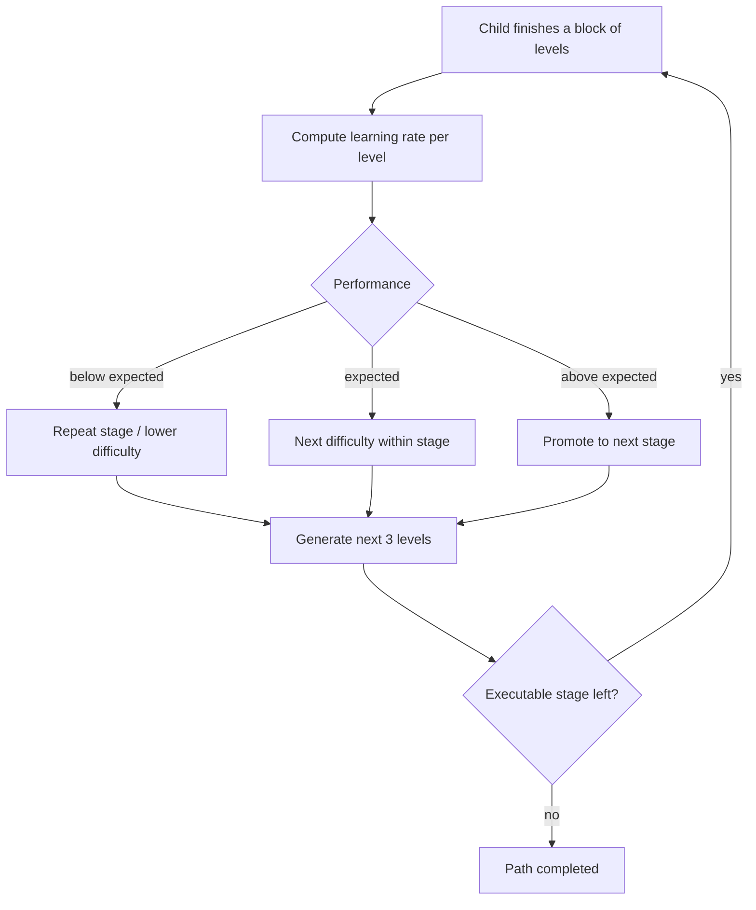

# Adaptive Policy

The Adaptive Policy decides, after each block of levels, what a child should practise next.

## Concepts

- **Policy version** — one curriculum per language (Spanish / Catalan) and age band.
- **Stage** — an ordered step of the curriculum. Each stage targets one phonological skill
  (e.g. initial-sound identification, final-sound identification, syllable segmentation) with a
  content range (number of syllables) and a starting difficulty.
- **Level** — a playable therapy plan generated from a stage.
- **Learning rate** — a score computed from the results of a level; it is labelled (e.g. low /
  expected / high) and drives progression.

## Decision loop

<!-- TODO Esteban: keep this at the conceptual level; do not publish real thresholds or the
curriculum spreadsheet. -->

## Evolution

| Version | What changed |
|---|---|
| v1 | Curriculum per language and age, server-side learning rate, shared execution loop for 3 flows. |
| v2 | Refined result model and per-skill enablement per language; requirements for web and Unity clients. |
| v3 | **Home Discovery**: game-first onboarding + screening that chooses the starting stage. |
