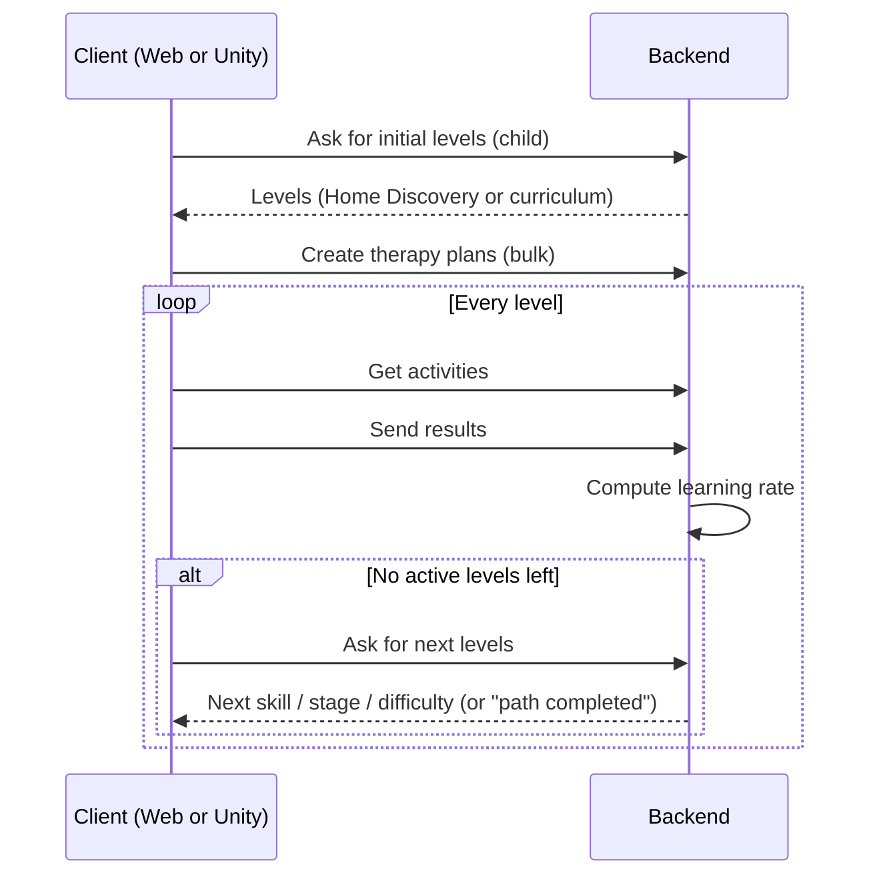

# Architecture

## Components

| Component | Responsibility |
|---|---|
| **Prescriber Web App** (Next.js / React) | Therapists and parents manage children, prescribe therapy, start the adaptive route and read progress reports (PDF export, charts). |
| **Picofon Mobile** (Unity) | The child plays phonological-awareness games. In the AI-prescribed flow it also creates the child and starts the adaptive route. |
| **Backend API** (FastAPI) | Auth and roles, therapy plans, activity generation, results, learning rate, Adaptive Policy and Home Discovery. |
| **MariaDB** | Children, therapy plans, results, curricula (configuration), screening. |
| **Firebase Auth** | Identity; the backend verifies the ID token and issues its own HttpOnly session. |

## Backend structure (feature-based)

Each domain is a self-contained feature module:

```
features/<feature>/
  router.py     # HTTP endpoints
  schemas.py    # Pydantic contracts (DTOs)
  service.py    # business logic (SQLAlchemy)
  constants.py  # domain constants and error codes
```

All responses use one envelope: `{ success, message: { content, displayable }, data }`, so
clients can decide whether a message is user-facing.

Roles: `ADMIN`, `THERAPIST`, `PARENT`, `INVITED`.

## The three therapy flows

| Flow | Who prescribes | Who starts the adaptive route |
|---|---|---|
| A — Therapist managed | Therapist | Web app |
| B — Therapist prescribed, parent assisted | Therapist | Web app |
| C — AI prescribed, parent assisted | Adaptive Policy | Mobile app |



**Architectural rule:** neither React nor Unity decides the policy, stage, next skill, learning
rate or difficulty. These belong to the backend.
