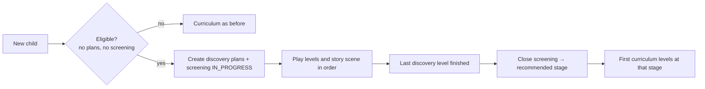

# Home Discovery (Adaptive Policy v3)

A short welcome route that a new child plays **before** the curriculum. It has two goals:

1. **Engagement** — start with the most fun activities and include a story scene.
2. **Screening** — decide at which curriculum stage the child should start.

## Configurable sequence (example)

| Step | Kind | Skill | Levels |
|---|---|---|---|
| 1 | Levels | Skill A | 3 |
| 2 | Levels | Skill B | 3 |
| 3 | Story scene | — | 1 |
| 4 | Levels | Skill C | 3 |

The sequence is data. Steps whose skill is not enabled for the child's language, or inactive
scenes, are skipped automatically. With no active steps, the system behaves exactly like v2.

## Flow

## Design choices

- **No new client loop.** Scenes are therapy plans with `plan_type = LUDIC_SCENE`; Unity only
  needed a renderer, chosen by type and id (never by name).
- **Opt-out for therapists.** In therapist flows the web app can skip discovery; in the
  AI-prescribed flow it always runs.
- **Strict validation.** Mixed batches, invalid steps or a second discovery for the same child are
  rejected with explicit error codes.
- **Safe rollout.** Existing children were not affected; schema changes shipped with
  verification, activation, monitoring and rollback scripts.
